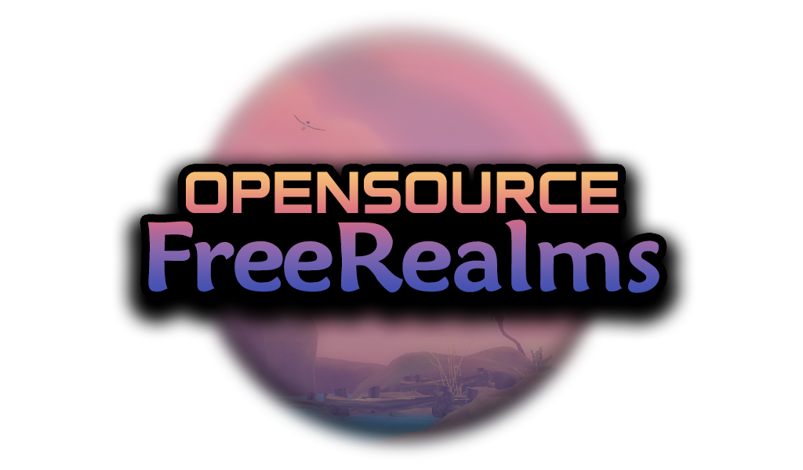

<div align="center">
  <a href="https://github.com/Open-Source-Free-Realms/Sanctuary">
    
  </a>

  <h1>Sanctuary</h1>

  <p>An open source server emulator for Free Realms, written from scratch in C#.</p>

  <p>
    <a href="https://github.com/Open-Source-Free-Realms/Sanctuary/wiki">Wiki</a>
    ·
    <a href="https://github.com/Open-Source-Free-Realms/Sanctuary/issues/new?labels=bug&template=bug-report---.md">Report a bug</a>
    ·
    <a href="https://github.com/Open-Source-Free-Realms/Sanctuary/issues/new?labels=enhancement&template=feature-request---.md">Request a feature</a>
  </p>

  <a href="https://github.com/Open-Source-Free-Realms/Sanctuary/graphs/contributors"></a>
  <a href="https://github.com/Open-Source-Free-Realms/Sanctuary/stargazers"></a>
  <a href="https://github.com/Open-Source-Free-Realms/Sanctuary/issues"></a>
  <a href="LICENSE"></a>
</div>

> **Disclaimer:** Sanctuary is a fan project. We do not own the rights to Free Realms. All Free Realms copyrights and trademarks belong to Daybreak Games. See [Legal](#legal).

## About

Sanctuary brings Free Realms back by reimplementing its servers. This repository contains only the **server**. To play, you also need a Free Realms client, which you can get from the [OSFR Launcher](https://github.com/Open-Source-Free-Realms/Launcher) or let `Sanctuary.DevClient` set one up for you (see [Connecting a client](#connecting-a-client)).

The server is made up of three programs:

| Program | Port | Protocol | What it does |
|---|---|---|---|
| `Sanctuary.WebAPI` | 20040 | HTTP | Registers accounts, logs players in and stores character portraits |
| `Sanctuary.Login` | 20042 | UDP | Handles Character Select and creating characters |
| `Sanctuary.Login` | 20041 | UDP | Internal connection from the Gateway |
| `Sanctuary.Gateway` | 20260 | UDP | Runs the game world |

## Requirements

| | Windows | Linux |
|---|---|---|
| To build | [.NET 10 SDK](https://dotnet.microsoft.com/download/dotnet/10.0) | [.NET 10 SDK](https://learn.microsoft.com/dotnet/core/install/linux) |
| To run | [.NET 9 and ASP.NET Core 9 runtimes](https://dotnet.microsoft.com/download/dotnet/9.0) | [.NET 9 and ASP.NET Core 9 runtimes](https://learn.microsoft.com/dotnet/core/install/linux) |
| To run the client | Nothing extra | [Wine](https://www.winehq.org/) |

The SDK version is set in `src/global.json`, and the projects target .NET 9, so you need both. SQLite works out of the box; MySQL and MariaDB are also supported.

Get the code first:

```sh
git clone https://github.com/Open-Source-Free-Realms/Sanctuary.git
cd Sanctuary
```

## Running the server

Pick whichever way suits you. All of them start the same three programs.

### Visual Studio (Windows)

You need a version of Visual Studio that supports the .NET 10 SDK, with the **ASP.NET and web development** workload.

1. Open `src/Sanctuary.slnx`.
2. Right-click `Sanctuary.Login` and choose **Manage User Secrets**. All the projects share the same secrets, so you only need to do this once.
3. Paste this in, changing the path to wherever you want the database:
   ```json
   {
     "Database": {
       "Provider": "Sqlite",
       "ConnectionString": "Data Source=C:/path/to/sanctuary.db"
     }
   }
   ```
4. Choose a launch profile in the toolbar and press **F5**:
   - **Play** builds and starts the servers and a game client, and closing the client stops the servers.
   - **Servers + WebAPI + Client** does the same with the debugger attached to the servers.
   - **Servers + WebAPI** only starts the servers.

### Visual Studio Code (Windows and Linux)

The repository already includes the build and launch configuration. It uses a SQLite database called `sanctuary.db` in the repository folder, so there's nothing to configure.

1. Open the repository's root folder in VS Code.
2. Install the [C# extension](https://marketplace.visualstudio.com/items?itemName=ms-dotnettools.csharp).
3. Open **Run and Debug**, choose one of these and press **F5**:
   - **Play** builds and starts the servers and a game client, and closing the client stops the servers.
   - **Servers + WebAPI + Client** does the same with the debugger attached to the servers.
   - **Servers + WebAPI** only starts the servers.

If you run a single program such as **Login** on its own, press **Ctrl+Shift+B** to build first.

### Command line (Windows and Linux)

Set the database location. The folder must already exist.

On Windows (PowerShell):

```powershell
$env:Database__Provider = "Sqlite"
$env:Database__ConnectionString = "Data Source=C:/path/to/sanctuary.db"
```

On Linux:

```sh
export Database__Provider=Sqlite
export Database__ConnectionString="Data Source=/path/to/sanctuary.db"
```

Then, from the `src` folder, start each program in its own terminal with those variables set. Start Login first, because it creates and updates the database.

```sh
dotnet run --project Sanctuary.Login/Sanctuary.Login.csproj
dotnet run --project Sanctuary.Gateway/Sanctuary.Gateway.csproj
dotnet run --project Sanctuary.WebAPI/Sanctuary.WebAPI.csproj
```

Run these from `src` so the programs can find the `Resources` and `Scripts` folders.

### Docker Compose (Windows and Linux)

Docker Compose runs all three programs with MariaDB, so it needs no other setup:

```sh
cd src/Docker
docker compose up --build
```

To let other people connect, replace `localhost` in `Server__ServerAddress` in `docker-compose.yml` with your public IP address or domain name. Database settings can be changed with `MYSQL_ROOT_PASSWORD`, `MYSQL_DATABASE`, `MYSQL_USER` and `MYSQL_PASSWORD`.

### Other database options

For a Release build of Login or Gateway, you can put the same JSON shown above in a `database.json` file next to the program, instead of using environment variables. The WebAPI reads its database settings from environment variables or user secrets.

See the [database guide](src/Sanctuary.Database/README.md) for MySQL, MariaDB and creating migrations.

## Connecting a client

The **Play** option does all of this for you. It runs `Sanctuary.DevClient`, which:

1. Finds a client. It uses the folder you give it, then a `client` folder in the repository, then your OSFR Launcher install. If it finds none of those, it downloads one into `client`.
2. Builds and starts Login, the Gateway and the WebAPI in order, and waits for each one to be ready. Server output goes to the `logs` folder.
3. Logs in as the account `test`, creating it if it doesn't exist.
4. Starts the game, using Wine on Linux, and stops the servers when you close it.

You can also run it from the `src` folder. Everything after `--` is passed to the program.

```sh
dotnet run --project Sanctuary.DevClient/Sanctuary.DevClient.csproj                         # start everything and log in as "test"
dotnet run --project Sanctuary.DevClient/Sanctuary.DevClient.csproj -- -n 2                 # two clients, logged in as "test" and "test2"
dotnet run --project Sanctuary.DevClient/Sanctuary.DevClient.csproj -- -l myaccount         # log in as another account
dotnet run --project Sanctuary.DevClient/Sanctuary.DevClient.csproj -- -g 1                 # go straight into the world as character ID 1
dotnet run --project Sanctuary.DevClient/Sanctuary.DevClient.csproj -- --client /path/to/client
dotnet run --project Sanctuary.DevClient/Sanctuary.DevClient.csproj -- --no-servers         # use servers you started yourself
dotnet run --project Sanctuary.DevClient/Sanctuary.DevClient.csproj -- -a 192.168.1.5       # connect to another machine
```

You can also set the client's location once with the `SANCTUARY_CLIENT_PATH` environment variable.

Accounts created this way have the password `testtest`. `-g` needs a character that already exists. With `-n`, the first client uses your normal client folder and each extra client gets its own full copy in `client-2`, `client-3` and so on, because clients running at the same time can't share a folder.

To launch a client yourself, get a session from `POST /login` on the WebAPI (with a JSON body of `username` and `password`, or `POST /register` first for a new account), then start the client with:

```sh
FreeRealms.exe Internationalization:Locale=8 Server=127.0.0.1:20042 SessionId=<sessionId> AssetDelivery:IndirectServerAddress=http://osfr.editz.dev/assets Portrait:UploadUrl=http://127.0.0.1:20040/image
```

## Accounts and staff permissions

There is no default admin account. To make an account an admin or moderator, change it in the database and log in again:

```sql
UPDATE Users SET IsAdmin = 1 WHERE Username = 'myaccount';
UPDATE Users SET IsMod = 1 WHERE Username = 'myaccount';
```

Once you're an admin, you can promote other players in-game with `!admin promote <player>`.

## Chat commands

Type these in chat. All commands start with `!`.

| Command | Usage | Role |
|---|---|---|
| `!help` | | Player |
| `!whereami` | | Player |
| `!zone` | `ls` | Player |
| `!navnpcto` | `spawn [count] [radius]`, `moveto [<x> <y> <z>]`, `chase`, `stop` or `despawn` | Player |
| `!teleport` | `<x> <y> <z>` | Mod |
| `!mod` | `ban\|mute <player> <minutes>` or `unban\|unmute <player>` | Mod |
| `!admin` | `promote\|demote <player>` | Admin |
| `!npc` | `spawn <definitionId>` or `despawn [guid]` | Admin |
| `!mount` | `<model_id> [tint_id] [flying]` | Admin |
| `!scale` | `<multiplier> [seconds]` or `reset` | Admin |
| `!quest` | `reset <questId> [player]` | Admin |
| `!reward` | `<tableKey>` | Admin |
| `!collection` | `pools`, `configure [pool] [maxActive] [respawnSeconds]`, `place [pool]`, `remove [radius\|#id]` or `list [pool] [page]` | Admin |
| `!script` | `reload`, `add <zone\|npc> <scriptName>` or `remove <zone\|npc> <scriptName>` | Admin |
| `!oob` | | Admin |

## Configuration

Each program reads its settings from a file next to it. Any setting can also be overridden with an environment variable, for example `Server__ServerAddress`.

**`login.json`** (`src/Sanctuary.Login/login.json`)

| Setting | Default | Purpose |
|---|---|---|
| `Port` | `20042` | Port players connect to |
| `LoginGatewayPort` | `20041` | Port the Gateway connects to |
| `LoginGatewayChallenge` | | Shared secret; must match the Gateway's |
| `IsLocked` | `false` | Locks the server |
| `DefaultTitleId` | `0` | Title given to new characters |
| `DefaultProfileId` | `1` | Job given to new characters |
| `StartingCoins` | `999999999` | Coins given to new characters |
| `StartingStationCash` | `999999999` | Station Cash given to new characters |
| `UnlockAllTitles` | `true` | Gives new characters every title |
| `UnlockAllProfiles` | `true` | Gives new characters every job |

The defaults are meant for development, so change the starting currency, unlocks and `LoginGatewayChallenge` before running a public server.

**`gateway.json`** (`src/Sanctuary.Gateway/gateway.json`)

| Setting | Default | Purpose |
|---|---|---|
| `Port` | `20260` | Port players connect to |
| `UseCompression` | `true` | Compresses packets |
| `Environment` | `live` | Environment name sent to the client |
| `ClientVersion` | `1.910.1.530630` | Client version the server expects |
| `ServerAddress` | `127.0.0.1:20260` | Address given to clients; use your public address for a public server |
| `LoginGatewayAddress` | `localhost:20041` | Where to reach the Login server |
| `LoginGatewayChallenge` | | Shared secret; must match Login's |
| `ShowMemberNagScreen` | `false` | Shows the membership prompt |

**`appsettings.json`** (`src/Sanctuary.WebAPI/appsettings.json`)

| Setting | Default | Purpose |
|---|---|---|
| `WebAPI:LaunchArguments` | Asset and portrait URLs | Arguments returned to clients at login |
| `WebAPI:MemberByDefault` | `true` | Makes new accounts members |
| `Urls` | `http://127.0.0.1:20040` | Address the WebAPI listens on |

## Project layout

```
src/
  Sanctuary.Core            Shared helpers and configuration
  Sanctuary.Database*       Database models, plus the MySQL and SQLite providers
  Sanctuary.DevClient       Sets up and starts a game client for development
  Sanctuary.Game            Game logic: zones, entities, NPCs, chat commands
  Sanctuary.Gateway         World server and its packet handlers
  Sanctuary.Login           Login and Character Select server
  Sanctuary.Packet*         Packet definitions
  Sanctuary.Scripting       Lua scripting engine
  Sanctuary.UdpLibrary      Network protocol
  Sanctuary.WebAPI          Accounts, sessions and portraits
  Sanctuary.*.Tests         Unit tests
  Docker                    Dockerfiles and Compose setup
  Resources                 Game data such as items, quests, stores and zones
  Scripts                   Lua scripts for NPCs and zones
```

## Running the tests

```sh
cd src
dotnet test Sanctuary.slnx
```

The database tests in CI run against MariaDB, so some may need a MariaDB server to pass locally.

## Contributing

Contributions are welcome. Please read [CONTRIBUTING.md](CONTRIBUTING.md) before opening a pull request, including its coding values and AI policy. Pull requests go to `main`.

For anything else, you can ask a contributor on GitHub or on our Discord.

<a href="https://github.com/Open-Source-Free-Realms/Sanctuary/graphs/contributors">
  
</a>

## License

The Sanctuary source code is licensed under the [GNU Affero General Public License v3.0](LICENSE). This license covers only Sanctuary's own code, not Free Realms.

## Legal

Free Realms and all related names, artwork, game data and other content are the property of Daybreak Games. All copyright belongs to Daybreak Games. Sanctuary is an unofficial, community-made project and is not affiliated with or endorsed by Daybreak Games.
